<div align="center">

  <!-- Header Banner -->
  

  <!-- Dynamic Typing SVG Subtitle -->
  <a href="#about-me">
    
  </a>

  <br/><br/>

  <!-- Social & Profile Badges -->
  <a href="https://www.linkedin.com/in/vedant-mishra-8b3987328/" target="_blank">
    
  </a>
  &nbsp;
  <a href="https://mail.google.com/mail/?view=cm&fs=1&to=vedantmanikmishra@gmail.com&su=Hello%20Vedant%20-%20Opportunity%20Inquiry" target="_blank">
    
  </a>
  &nbsp;
  <a href="https://x.com/Vedant_mishra_7" target="_blank">
    
  </a>
  &nbsp;
  <a href="https://vedantoncloud.github.io" target="_blank">
    
  </a>
  &nbsp;
  <a href="https://hub.docker.com/u/vedantoncloud" target="_blank">
    
  </a>
  &nbsp;
  

</div>

<br/>

---

<a name="about-me"></a>
### 👨‍💻 About Me

```yaml
Name: Vedant Mishra
Location: Pune, India
Specialization: Cloud Computing, DevOps & Infrastructure Automation
Education: B.Tech in CSE (Cloud Computing) @ MIT ADT University, Pune (2024 - 2028 | CGPA: 7.78)
Experience:
  - Cloud Engineering Intern @ HEPro AI (Serverless, AWS Lambda, API Gateway, DynamoDB)
  - Cloud Computing Trainee @ Oracle Academy & Oracle University (OCI, Multicloud)
Hackathons:
  - Kumbhathon: Selected / Finalist
  - Smart India Hackathon (SIH): Participant (2024, 2025) & Volunteer / Organizer (2026)
Current Focus: CloudForge (Mini PaaS), Automated CI/CD, FinOps (Cloud Cost Optimization)
Open For: Cloud Engineer, DevOps Engineer, SRE & Platform Engineering Roles
```

* ☁️ **Cloud Practitioner & Architect**: Deep hands-on experience designing and deploying scalable architectures across **AWS** (Lambda, API Gateway, S3, DynamoDB, CloudWatch, IAM) and **Oracle Cloud Infrastructure (OCI)**.
* 🐳 **Containerization & CI/CD**: Building resilient deployment pipelines using **Docker**, **GitHub Actions**, and container registries to deploy production-ready services on platforms like **Render** and **AWS**.
* ⚡ **Platform & Automation Engineer**: Engineered **CloudForge**, a mini Platform-as-a-Service (PaaS) automating repository cloning, image building, and container runtime orchestration.
* 💰 **FinOps Enthusiast**: Authored intelligent bots integrating AWS Cost Explorer & CloudWatch to monitor daily burn rates, forecast 7-day cloud expenses, and fire real-time threshold notifications.

---

### 🏆 Hackathons & Leadership

<div align="center">

| Event | Role / Recognition | Highlights & Impact |
| :--- | :---: | :--- |
| 🥇 **Kumbhathon** | **Selected / Finalist** | Innovated and engineered a high-impact technology solution selected among competitive nationwide teams. |
| 🚀 **Smart India Hackathon (SIH 2024 & 2025)** | **Innovator / Participant** | Built scalable solutions addressing critical real-world problem statements under 36-hour sprint deadlines. |
| 🤝 **Smart India Hackathon (SIH 2026)** | **Volunteer / Organizer** | Facilitated ground operations, technical logistics, and mentorship coordination for hackathon participants. |

</div>

---

<a name="technical-arsenal"></a>
### 🛠️ Technical Arsenal

<div align="center">

| Domain | Technologies & Tools |
| :--- | :--- |
| **Cloud Providers & Services** |        |
| **DevOps & Containers** |       |
| **Backend & Development** |       |
| **Databases** |   |
| **Monitoring & Utilities** |      |

<br/>

<!-- Modern Skill Icons Bar (Anchored in-page so clicking does not redirect externally) -->
<a href="#technical-arsenal">
  
</a>

</div>

---

### 🚀 Featured Projects

<table>
  <tr>
    <td width="50%" valign="top">
      <h3 align="center">🛠️ CloudForge – Mini PaaS</h3>
      <p align="center">
        <a href="https://github.com/vedantoncloud/Cloudforge" target="_blank">
          
        </a>
      </p>
      <p>
        A lightweight <b>Platform-as-a-Service (PaaS)</b> backend built to automate application deployments.
      </p>
      <ul>
        <li>Automated Git repository cloning, Dockerfile detection, and image compilation.</li>
        <li>Container lifecycle management and live build log streaming.</li>
        <li>Secured with JWT authentication, project ownership controls, and granular REST APIs.</li>
      </ul>
      <p>
        <code>FastAPI</code> • <code>Docker</code> • <code>MySQL</code> • <code>SQLAlchemy</code> • <code>JWT</code>
      </p>
    </td>
    <td width="50%" valign="top">
      <h3 align="center">⚡ End-to-End DevOps CI/CD Pipeline</h3>
      <p align="center">
        <a href="https://github.com/vedantoncloud/myapp" target="_blank">
          
        </a>
      </p>
      <p>
        Automated production CI/CD delivery pipeline implementing automated verification and deployment.
      </p>
      <ul>
        <li>Automated testing on every pull request using Jest.</li>
        <li>Automated Docker image builds pushed to Docker Hub via repository secrets.</li>
        <li>Automated production deployment webhooks triggering live releases on Render.</li>
      </ul>
      <p>
        <code>Node.js</code> • <code>GitHub Actions</code> • <code>Docker</code> • <code>Render</code> • <code>Jest</code>
      </p>
    </td>
  </tr>
  <tr>
    <td width="50%" valign="top">
      <h3 align="center">🤖 AWS Cloud Cost Prediction Bot</h3>
      <p align="center">
        <a href="https://github.com/vedantoncloud/CC-Prediction-Bot" target="_blank">
          
        </a>
      </p>
      <p>
        Intelligent FinOps assistant to keep cloud infrastructure spending transparent and under budget.
      </p>
      <ul>
        <li>Integrates directly with AWS Cost Explorer and CloudWatch metric APIs.</li>
        <li>Provides automated daily cost snapshots and dynamic 7-day usage forecasting.</li>
        <li>Real-time Telegram notifications when spending crosses designated thresholds.</li>
      </ul>
      <p>
        <code>Python</code> • <code>AWS Cost Explorer</code> • <code>CloudWatch</code> • <code>Telegram Bot API</code>
      </p>
    </td>
    <td width="50%" valign="top">
      <h3 align="center">🧠 CloudOps-AI — Flagship Autonomous Platform</h3>
      <p align="center">
        <a href="https://github.com/vedantoncloud/CloudOps-AI" target="_blank">
          
        </a>
      </p>
      <p>
        Intelligent <b>autonomous cloud operations platform</b> moving beyond passive monitoring toward AI-driven incident diagnosis, controlled remediation, and auditability.
      </p>
      <ul>
        <li><b>AI Incident Analysis:</b> Synthesizes telemetry to diagnose anomalies and formulate automated remediation plans.</li>
        <li><b>Safety & Rollbacks:</b> Enforces dry-run verification, state snapshots, and automatic rollback safeguards.</li>
        <li><b>Auditability:</b> Tamper-evident hash-chained audit trails with STS AssumeRole least-privilege access.</li>
      </ul>
      <p>
        <code>Python</code> • <code>FastAPI</code> • <code>AWS</code> • <code>Docker</code> • <code>MySQL/SQLite</code> • <code>CI/CD</code>
      </p>
    </td>
  </tr>
</table>

---

### 📜 Certifications & Verified Credentials

<div align="center">

| Certificate | Issuing Organization | Verification Link |
| :--- | :---: | :---: |
| 🛡️ **Oracle Multicloud Architect Professional** | Oracle | [**View Credential ↗**](https://www.linkedin.com/in/vedant-mishra-8b3987328/details/certifications/) |
| ☁️ **Oracle Cloud Infrastructure Foundations Associate** | Oracle | [**View Credential ↗**](https://www.linkedin.com/in/vedant-mishra-8b3987328/details/certifications/) |
| 🚀 **AWS Cloud Practitioner Essentials** | Amazon Web Services (AWS) | [**View Credential ↗**](https://www.linkedin.com/in/vedant-mishra-8b3987328/details/certifications/) |
| 🌐 **The Bits and Bytes of Computer Networking** | Google | [**View Credential ↗**](https://www.linkedin.com/in/vedant-mishra-8b3987328/details/certifications/) |

<br/>

<a href="https://www.linkedin.com/in/vedant-mishra-8b3987328/details/certifications/" target="_blank">
  
</a>

</div>

---

### 📊 GitHub Activity & Realtime Metrics

<div align="center">

  <!-- GitHub Stats Card (Realtime with all commits and private counts included) -->
  
  &nbsp;
  <!-- Top Languages Card -->
  

  <br/><br/>

  <!-- GitHub Streak Card (Updated with Indian Timezone & High-Accuracy Calc) -->
  

  <br/><br/>

  <!-- Dynamic Activity Graph (Served from the repository workflow for zero downtime) -->
  

</div>

---

### 🐍 Contribution Activity Snake

<div align="center">
  <picture>
    <source media="(prefers-color-scheme: dark)" srcset="https://raw.githubusercontent.com/vedantoncloud/vedantoncloud/output/github-contribution-grid-snake-dark.svg">
    <source media="(prefers-color-scheme: light)" srcset="https://raw.githubusercontent.com/vedantoncloud/vedantoncloud/output/github-contribution-grid-snake.svg">
    
  </picture>
</div>

---

### 🤝 Connect With Me

<div align="center">

  <a href="https://www.linkedin.com/in/vedant-mishra-8b3987328/" target="_blank">
    
  </a>
  &nbsp;
  <a href="https://mail.google.com/mail/?view=cm&fs=1&to=vedantmanikmishra@gmail.com&su=Hello%20Vedant" target="_blank">
    
  </a>
  &nbsp;
  <a href="https://x.com/Vedant_mishra_7" target="_blank">
    
  </a>
  &nbsp;
  <a href="https://vedantoncloud.github.io" target="_blank">
    
  </a>
  &nbsp;
  <a href="https://github.com/vedantoncloud" target="_blank">
    
  </a>

  <br/><br/>
  
  <i>"Automating the cloud, one container and pipeline at a time."</i>

  <br/><br/>

  <!-- Footer Banner -->
  

</div>
